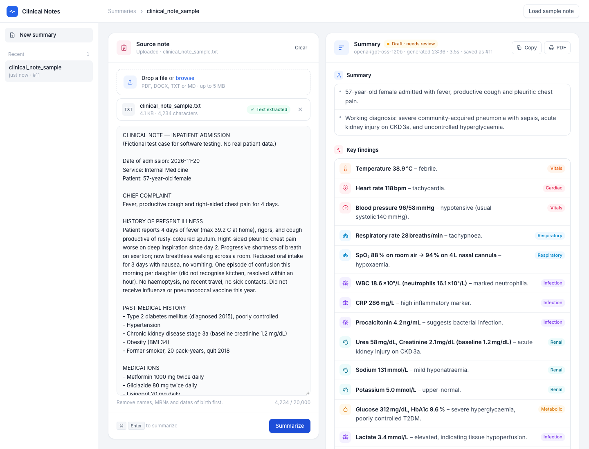

# AI Clinical Note Summarizer

A Laravel app that turns long, unstructured clinical notes into a structured handover: a short **summary**, the **key findings** with their values, and a numbered list of **suggested follow-up** actions. Paste a note or upload a PDF, DOCX or text file and get a summary in a few seconds.



> The note in the screenshot is a fictional test case. This tool is decision support only. AI output can be incomplete or wrong, so check every line against the source note before it informs care.

## What it does

- **Paste or upload.** Drag in a PDF, DOCX, TXT or MD file (up to 5 MB). The text is extracted in the browser and shown for review before anything is sent.
- **Structured output.** The model must return exactly three sections: Summary, Key findings (each led by the value, e.g. **Creatinine 2.1 mg/dL**) and Suggested follow-up (most urgent first). It is told to use only facts stated in the note.
- **Findings at a glance.** Each finding gets an icon and a category tag (Vitals, Cardiac, Respiratory, Infection, Renal, Metabolic, Imaging, Neuro, Alert…). Each follow-up step gets an action icon (medication, IV/injection, labs, imaging, referral, scheduling).
- **Traceable results.** Every summary is saved to the database and shows the model, the generation time and its record number.
- **Recent summaries.** The sidebar lists summaries made in this browser so you can reopen them.
- **Copy or print.** Copy the summary as markdown, or print / save it as PDF.

## How it works

```
Browser (resources/views/clinical.blade.php)
  ├─ PDF.js / Mammoth extract text from uploaded files (client-side)
  └─ POST /api/summarize { note }
        │
        ▼
ClinicalNoteController@summarize
  ├─ validates note (required, ≤ 20,000 characters)
  ├─ calls Groq's OpenAI-compatible chat API (openai-php client)
  └─ stores note + summary in clinical_summaries
        │
        ▼
JSON { record, summary } → rendered as markdown (sanitised with DOMPurify)
```

## Tech stack

- Laravel 12 on PHP 8.2+
- [Groq](https://groq.com) inference, default model `openai/gpt-oss-120b`, through [`openai-php/laravel`](https://github.com/openai-php/laravel)
- Tailwind CSS (CDN), marked + DOMPurify, PDF.js, Mammoth
- MySQL or SQLite

## Getting started

```bash
git clone https://github.com/henryhkb/ai-clinical-note-summarizer.git
cd ai-clinical-note-summarizer

composer install
cp .env.example .env
php artisan key:generate
```

Set your database and Groq credentials in `.env`:

```dotenv
DB_CONNECTION=mysql
DB_DATABASE=ai_medical_summary

GROQ_API_KEY=your_groq_api_key
GROQ_MODEL=openai/gpt-oss-120b   # optional; any chat model your Groq key can use
```

Then run:

```bash
php artisan migrate
php artisan serve
```

Open <http://localhost:8000>. Select **Load sample note** to try it without your own data.

### Changing the model

Groq retires models from time to time. If you see *"The model … does not exist or you do not have access to it"*, list what your key can use and set `GROQ_MODEL` to one of them:

```bash
curl -s https://api.groq.com/openai/v1/models -H "Authorization: Bearer $GROQ_API_KEY"
```

Run `php artisan config:clear` afterwards if you cache config.

## API

### `POST /api/summarize`

```json
{ "note": "68-year-old male presenting with 3 days of progressive shortness of breath…" }
```

**200 OK**

```json
{
  "record": { "id": 12, "note": "…", "summary": "…", "created_at": "…", "updated_at": "…" },
  "summary": "## Summary\n- …\n\n## Key findings\n- **BNP 2,340 pg/mL** — …\n\n## Suggested follow-up\n1. …"
}
```

**422** when `note` is missing or longer than 20,000 characters.

## Project structure

```
app/Http/Controllers/ClinicalNoteController.php   # prompt, Groq call, persistence
app/Models/ClinicalSummary.php
config/services.php                               # groq.key / groq.base_uri / groq.model
database/migrations/…_create_clinical_summaries_table.php
resources/views/clinical.blade.php                # the whole UI
routes/api.php                                    # POST /api/summarize
routes/web.php                                    # / → summarizer
docs/screenshot.png
```

## Privacy and limitations

- **No authentication yet.** Anyone who can reach the server can call `/api/summarize`. Add auth and rate limiting before exposing it beyond your machine.
- **Notes are sent to Groq** and **stored unencrypted** in `clinical_summaries`. Remove direct identifiers (names, MRNs, dates of birth) first, and don't use real patient data without the agreements and safeguards your setting requires.
- **Scanned PDFs** have no text layer and need OCR before upload.
- The "Recent" list lives in the browser's local storage, not on the server.

## Roadmap

- Authentication and per-user history
- Encryption at rest for notes and summaries
- Source citations: link each finding back to the sentence it came from
- OCR for scanned documents
- Feature tests with a mocked Groq client

## License

MIT
